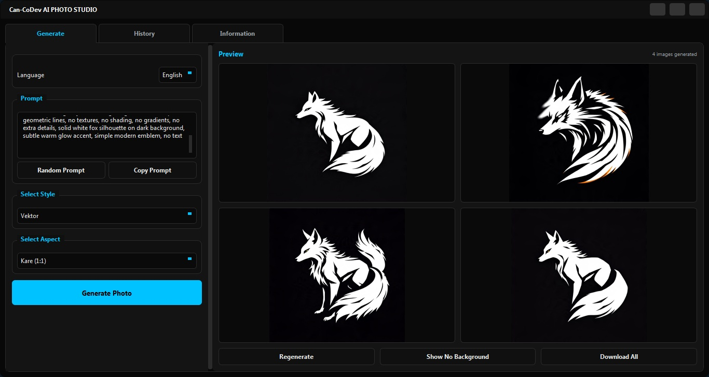

<div align="center">

# Can-Codev AI Photo Studio


**A desktop application for generating AI images from text prompts.**  
**Metin açıklamalarından yapay zeka görselleri oluşturmak için geliştirilen masaüstü uygulaması.**

[English](#english) | [Türkçe](#turkce)

</div>

---

<div align="center">



</div>

---

<a id="english"></a>

## English

**Can-Codev AI Photo Studio** is a Python and PyQt5 desktop application that sends text prompts to Photoroom services to generate images. Choose a visual style and aspect ratio, preview the results, and save your favorite images.

The application includes a dark interface with cyan accents and supports switching between English and Turkish.

### Features

- **Text-to-image generation:** Requests four image variations per generation.
- **75+ style choices:** Includes Anime, Realistic, Cyberpunk, Oil Painting, Watercolor, Pixel Art, and more.
- **10 aspect-ratio options:** Includes square, portrait, landscape, and panoramic selections.
- **Automatic prompt enhancement:** Adds randomized camera, lighting, atmosphere, and artistic details to your description.
- **Background-free previews:** View and download background-removed versions when provided by the service.
- **Image preview:** Click a generated image to open a larger preview.
- **Individual and batch downloads:** Save one image or download the current results to a selected folder.
- **Session history:** Review previous generations and double-click an entry to reopen its first image.
- **Prompt tools:** Generate random prompt ideas and copy your prompt to the clipboard.
- **English and Turkish interface:** Change the interface language from the generation page.

### Requirements

- Python 3.8 or newer
- pip

### Installation

1. Clone or download the repository:

   ```bash
   git clone https://github.com/can-codev/can-codev-ai-photo-studio.git
   cd can-codev-ai-photo-studio
   ```

2. Install the dependencies:

   ```bash
   pip install -r requirements.txt
   ```

3. Run the application:

   ```bash
   python main.py
   ```

### How to Use

1. Open the **Generate** tab.
2. Select your preferred interface language from **Language**.
3. Enter a prompt containing at least three characters, or click **Random Prompt**.
4. Choose a style and aspect ratio.
5. Click **Generate Photo** and wait for the results.
6. Click an image to open its preview, then select **Download** to save it.
7. Use **Download All** to save the current images to a folder.
8. If available, click **Show No Background** to inspect background-removed versions.
9. Open **History** to view earlier generations from the current session.

### Notes and Limitations

- Image generation requires access to the external service. Availability, response times, and output quality may vary.
- History is stored in memory only and is cleared when the application closes.
- Several aspect-ratio options map to the same service size preset. The output may not exactly match the selected ratio.
- Some style names and informational text remain in Turkish when English is selected.
- Background-removed images are available only when returned by the service.
- Prompts are sent to an external service. Avoid entering sensitive or confidential information.

### Service and Security

This is an independent project, not an official Photoroom application. Use third-party services only with appropriate authorization and in accordance with their terms.

The current code disables TLS certificate verification for some requests. Enable certificate verification before using it in a security-sensitive environment.

---

<a id="turkce"></a>

## Türkçe

**Can-Codev AI Photo Studio**, metin açıklamalarını Photoroom servislerine göndererek görsel üretmek için hazırlanmış, Python ve PyQt5 tabanlı bir masaüstü uygulamasıdır. Görsel tarzını ve en-boy oranını seçebilir, sonuçları önizleyebilir ve beğendiğiniz görselleri kaydedebilirsiniz.

Uygulama, mavi vurgulara sahip koyu bir arayüz sunar ve Türkçe ile İngilizce arasında geçiş yapmayı destekler.

### Özellikler

- **Metinden görsel üretimi:** Her üretimde dört görsel varyasyonu talep eder.
- **75'ten fazla stil seçeneği:** Anime, Gerçekçi, Cyberpunk, Yağlı Boya, Sulu Boya, Piksel ve daha fazlası.
- **10 en-boy oranı seçeneği:** Kare, portre, yatay ve panoramik seçimler.
- **Otomatik prompt zenginleştirme:** Açıklamanıza rastgele kamera, ışıklandırma, atmosfer ve sanatsal detaylar ekler.
- **Arka plansız önizleme:** Servis tarafından sağlandığında arka planı kaldırılmış görselleri görüntüleme ve indirme.
- **Görsel önizleme:** Üretilen görsele tıklayarak daha büyük bir pencerede inceleme.
- **Tekli ve toplu indirme:** Bir görseli veya mevcut sonuçların tamamını seçtiğiniz klasöre kaydetme.
- **Oturum geçmişi:** Önceki üretimleri listeleme ve bir kayda çift tıklayarak ilk görselini yeniden açma.
- **Prompt araçları:** Rastgele açıklama önerileri ve promptu panoya kopyalama.
- **Türkçe ve İngilizce arayüz:** Üretim sayfasından arayüz dilini değiştirme.

### Gereksinimler

- Python 3.8 veya daha yeni bir sürüm
- pip

### Kurulum

1. Depoyu klonlayın veya indirin:

   ```bash
   git clone https://github.com/can-codev/can-codev-ai-photo-studio.git
   cd can-codev-ai-photo-studio
   ```

2. Gerekli paketleri yükleyin:

   ```bash
   pip install -r requirements.txt
   ```

3. Uygulamayı çalıştırın:

   ```bash
   python main.py
   ```

### Nasıl Kullanılır?

1. **Fotoğraf Üret** sekmesini açın.
2. **Dil** menüsünden kullanmak istediğiniz arayüz dilini seçin.
3. En az üç karakterlik bir açıklama yazın veya **Rastgele Prompt** butonuna tıklayın.
4. Bir stil ve en-boy oranı seçin.
5. **Fotoğraf Üret** butonuna basın ve sonuçların gelmesini bekleyin.
6. Bir görsele tıklayarak önizlemesini açın, ardından **İndir** ile kaydedin.
7. Mevcut görselleri bir klasöre kaydetmek için **Tümünü İndir** seçeneğini kullanın.
8. Kullanılabilir olduğunda **Arka Plansız Göster** butonuyla arka planı kaldırılmış sürümleri inceleyin.
9. Aynı oturumdaki önceki üretimleri görmek için **Geçmiş** sekmesine geçin.

### Notlar ve Sınırlamalar

- Görsel üretimi harici servise erişim gerektirir. Servisin kullanılabilirliği, yanıt süresi ve çıktı kalitesi değişebilir.
- Geçmiş yalnızca bellekte tutulur; uygulama kapatıldığında silinir.
- Bazı en-boy oranı seçenekleri aynı servis boyutuna eşlenir. Çıktı, seçilen oranla birebir örtüşmeyebilir.
- İngilizce seçildiğinde bazı stil isimleri ve bilgilendirme metinleri Türkçe kalır.
- Arka plansız görseller yalnızca servis tarafından döndürüldüğünde kullanılabilir.
- Promptlar harici bir servise gönderilir. Hassas veya gizli bilgiler girmeyin.

### Servis ve Güvenlik

Bu bağımsız bir projedir; resmi bir Photoroom uygulaması değildir. Üçüncü taraf servisleri yalnızca gerekli yetkiyle ve ilgili kullanım koşullarına uygun şekilde kullanın.

Mevcut kod bazı isteklerde TLS sertifika doğrulamasını kapatır. Güvenlik açısından hassas bir ortamda kullanmadan önce sertifika doğrulamasını etkinleştirin.

---

<div align="center">

## Author / Yapımcı

**Can-Codev**

[GitHub](https://github.com/can-codev)

</div>
